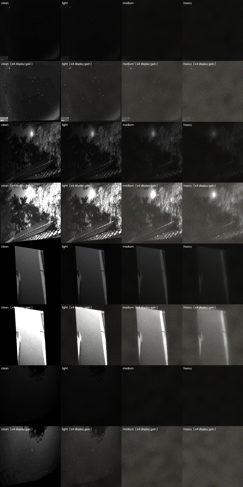
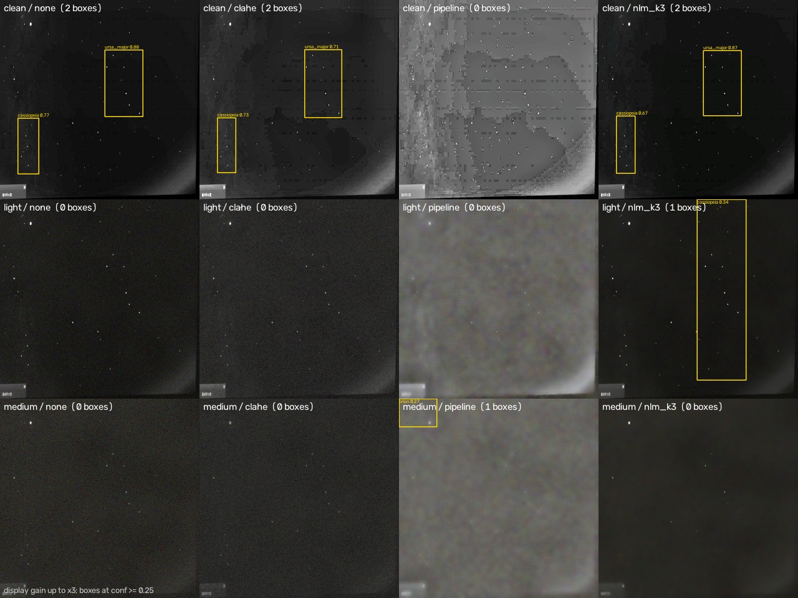

# Constellation Detection in Foggy, Low-Light Sky Images

Course project: *Low-Light Image Enhancement using Spatial and Copy-Paste
Techniques*. A YOLOv8n detector finds constellations in night-sky images. We
then measure how fog and low light break it, and how much classical
enhancement and training-time augmentation (fog, copy-paste) recover.

All numbers below come from result files saved under `results/constellation/`.

## Status

| Phase | What | State |
|---|---|---|
| 1 | Dataset check and leak-free re-split | done |
| 2 | YOLOv8n baseline (Colab T4) | done |
| 3 | Fog + low-light simulator, baseline under fog | done |
| 4 | Classical enhancement before detection | done |
| 5 | Retrain with fog / fog + copy-paste | done |
| 6 | Results table, figures | planned |
| 7 | Constellation stick figures | planned |

## Dataset

Roboflow Universe, `course-work-cytun/constellation-detector` v1 (Public
Domain), 16 classes. The published splits share source images, so every
phase uses the block re-split made by `src/constellation/resplit_dataset.py`
(seed 0): 3294 train, 97 valid and 92 test images.

## Results so far

Baseline YOLOv8n (100 epochs, 640 px), test split, 92 images, 283 boxes:

| Test images | mAP50 | mAP50-95 |
|---|---|---|
| Clean | 0.866 | 0.454 |
| Light fog | 0.070 | 0.032 |
| Medium fog | 0.022 | 0.006 |
| Heavy fog | 0.019 | 0.005 |

Applying one part of "light" at a time shows that sensor noise causes most
of the drop (mAP50 0.140 with noise alone, 0.789 with fog alone, 0.842 with
darkening alone). The dataset images are almost noise-free, so the baseline
never saw grain during training.



### Enhancement before detection (Phase 4)

The baseline detector is left unchanged and each method is applied to its
input. The setting was chosen on the validation split (best mean mAP50 over
clean and the three fog levels: non-local means with strength 3 × the
estimated noise) and then scored once on test. Test mAP50:

| Enhancement | Clean | Light | Medium | Heavy |
|---|---|---|---|---|
| None | 0.866 | 0.070 | 0.022 | 0.019 |
| Denoise (NLM, k=3) | 0.835 | **0.348** | 0.019 | 0.003 |
| Median 3×3 | 0.853 | 0.102 | 0.036 | 0.013 |
| CLAHE | 0.844 | 0.051 | 0.018 | 0.013 |
| Gamma 2.2 | 0.776 | 0.016 | 0.008 | 0.000 |
| Multi-scale Retinex | 0.358 | 0.002 | 0.004 | 0.000 |
| Classical brightening pipeline | 0.068 | 0.071 | 0.005 | 0.001 |
| Histogram equalisation | 0.016 | 0.005 | 0.000 | 0.000 |

- Denoising multiplies light-fog mAP50 by about 5. Nothing helps at medium or
  heavy fog: too little star signal is left for this detector.
- Brightening methods (pipeline, Retinex, histogram equalisation) hurt even on
  clean images. They push the frames far from the dark images the detector
  was trained on.
- Removing the fog background (sky-restore variants) also hurt on clean
  images and lost to plain denoising. All runs, including the k sweep, are in
  `results/constellation/phase4/`.



### Training with fog (Phase 5)

The detector is retrained (50 epochs, Colab T4) on the same training images,
each given a random condition: clean, light, medium or heavy fog. A second
model also gets constellations copy-pasted from other training images. The
test images are never used for training. Test mAP50:

| Detector | Clean | Light | Medium | Heavy |
|---|---|---|---|---|
| Original | 0.866 | 0.070 | 0.022 | 0.019 |
| Fog-trained | **0.869** | **0.849** | **0.833** | 0.697 |
| Fog-trained + copy-paste | 0.865 | 0.847 | 0.799 | **0.714** |

Training with fog fixes most of the drop and costs nothing on clean images.
Copy-paste makes no clear difference on top (one run each). Results are in
`results/constellation/phase5/`.

## Demo page

Pick a test image, choose Clean or Fog (the medium setting), and see the
fog-trained detector's boxes next to the true labels, plus the measured
results.

```bash
.venv-det/bin/pip install -r requirements-detection.txt
.venv-det/bin/uvicorn src.app.server:app --port 8000   # open http://localhost:8000
```

It needs the re-split dataset in `data/raw/constellations/resplit`. Fogged
images are read from `data/raw/constellations/fog` when present, otherwise
they are made on the fly.

## Fog and low-light simulator

`src/constellation/fog_sim.py` works in linear light and uses the haze model
I = J·t + A·(1 − t), with patchy optical depth, glow around bright sources,
reduced exposure, and Poisson + read noise. Each image's random seed comes
from its file name, so the output is identical every run.

```bash
python -m src.constellation.fog_sim --split test            # writes data/raw/constellations/fog/
python -m src.constellation.fog_stats --out results/constellation/phase3
```

## Setup

```bash
python -m venv .venv && .venv/bin/pip install -r requirements.txt
# detection (evaluation runs on CPU; training runs on Colab):
python -m venv .venv-det
.venv-det/bin/pip install torch==2.14.1 torchvision --index-url https://download.pytorch.org/whl/cpu
.venv-det/bin/pip install -r requirements-detection.txt
```

Evaluate a model on one test set:

```bash
.venv-det/bin/python src/constellation/eval_yolo.py \
    --weights results/constellation/phase2/baseline/weights/best.pt \
    --data data/raw/constellations/fog/light/data.yaml --split test --device cpu \
    --out results/constellation/phase3/baseline_test_light.json
```

## Layout

- `src/constellation/`: dataset checks, re-split, training, evaluation, fog simulator, enhancement
- `src/app/`: demo page (FastAPI + one HTML file)
- `src/classical/`, `src/pipeline/`: classical enhancement operators (CLAHE,
  Retinex, gamma, homomorphic filtering, denoising) used in Phase 4
- `colab/`: notebooks for GPU training
- `results/constellation/phaseN/`: saved outputs of each phase
