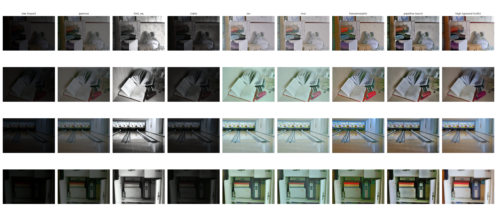
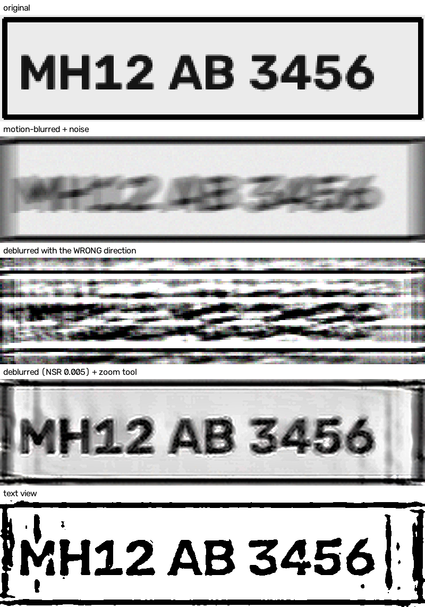

# Low-Light Image Enhancement

Turn a dark photo into a clear one using **classical image processing only**:
no AI, no neural networks, no training. Every step is a standard operation
from an image processing course (Retinex, gamma correction, filtering,
histogram equalization, colour spaces, Wiener deconvolution) and can be
explained on paper.

It comes with a **web app**. Take or upload a photo, watch it get enhanced
step by step, compare before and after with a slider, then zoom into a detail
such as a number plate to enlarge it, sharpen it and undo motion blur.



---

## Run it locally

### 1. Install

You need **Python 3.12** (what it was tested on) and git.

```bash
git clone https://github.com/Shreshtha-Ojha/lowlight-enhancement.git
cd lowlight-enhancement
python3 -m venv .venv
source .venv/bin/activate          # Windows (PowerShell): .venv\Scripts\Activate.ps1
pip install -r requirements.txt
```

### 2. Start the web app

```bash
cd src
uvicorn web.server:app --host 0.0.0.0 --port 8000
```

Open **http://localhost:8000** and use *Take a photo*, *Upload a photo*, or
one of the sample images. Stop the server with `Ctrl+C`.

**Opening it on your phone:** connect the phone to the same Wi-Fi and open
`http://<your-computer's-IP>:8000`. Find the IP with `ipconfig` on Windows,
or `ip addr` / `ifconfig` on Linux and macOS. If it doesn't load, allow port
8000 through the firewall.

<details>
<summary>Running inside WSL on Windows?</summary>

The phone can't reach WSL directly, so forward the port from Windows. In an
**administrator** PowerShell:

```powershell
$wsl = (wsl hostname -I).Trim().Split(" ")[0]
netsh interface portproxy add v4tov4 listenport=8000 listenaddress=0.0.0.0 connectport=8000 connectaddress=$wsl
New-NetFirewallRule -DisplayName "lowlight-demo" -Direction Inbound -LocalPort 8000 -Protocol TCP -Action Allow
```

Then use the **Windows** IP address from `ipconfig`. To undo:
`netsh interface portproxy delete v4tov4 listenport=8000 listenaddress=0.0.0.0`
and `Remove-NetFirewallRule -DisplayName "lowlight-demo"`.
</details>

### 3. Or use the command line

From `src/`:

```bash
python enhance_image.py dark.jpg -o enhanced.jpg                      # default ("natural")
python enhance_image.py dark.jpg -o enhanced.jpg --preset detail      # text, number plates
python enhance_image.py dark.jpg -o enhanced.jpg --steps-dir steps/   # also save every stage
python enhance_image.py dark.jpg -o enhanced.jpg --skip colour        # switch a stage off
```

Run `python enhance_image.py -h` for all options. Photos larger than 2000 px
are downscaled first (`--max-size 0` keeps full size).

### 4. Or run it with Docker

```bash
docker build -t lowlight .
docker run -p 7860:7860 lowlight     # then open http://localhost:7860
```

The same image works as a free [Hugging Face Docker Space](https://huggingface.co/docs/hub/spaces-sdks-docker)
if you want a public link.

---

## How it works

### The enhancement pipeline

`src/pipeline/stages.py`: each stage takes the image from the previous one.

| # | Stage | What it does | Topic |
|---|---|---|---|
| 1 | **Illumination map** | Takes the brightest of R, G, B at every pixel as "how much light fell here", then smooths it with a guided filter so it follows object edges | Retinex theory, spatial filtering |
| 2 | **Brighten** | Gamma correction applied to the illumination map rather than the image: dark areas get a big boost, bright ones almost none. Gamma is picked automatically (bisection) to reach a target brightness, and the same gain goes to R, G, B so colours don't shift | Point operations |
| 3 | **Denoise** | Non-local means, with strength set from the image's measured noise level (Immerkær's method), applied mostly where the photo was darkest | Noise, spatial filtering |
| 4 | **Local contrast** | CLAHE on the lightness channel of LAB only, so colours aren't distorted | Histogram processing |
| 5 | **Colour correction** | Gray-world white balance (capped, so a sunset doesn't turn grey) and an HSV saturation adjustment | Colour spaces |
| 6 | **Sharpen** | Unsharp masking: adds back a fraction of (image − blurred image) | Spatial filtering |

Brightening comes first because the other steps behave badly on near-black
pixels. Denoising comes before contrast and colour so they don't amplify
grain, and sharpening is last so it doesn't sharpen noise.

### Presets

| Preset | For | Settings |
|---|---|---|
| `natural` *(default)* | Everyday dark photos | Moderate denoising, gentle contrast, slight saturation boost, light sharpening |
| `detail` | Text, signs, number plates | Light denoising (strong denoising smears small text), stronger contrast and sharpening |
| `benchmark` | The measurements below | Settings chosen by comparing scores on reference photos; sharpening off |

### Zoom, deblur and text view

`src/pipeline/zoom.py`, used by the web app's *Zoom into a detail* section.
The selected area is cut from the brightened image (before denoising can
smooth fine detail away), then:

1. **Motion deblur (optional):** Wiener deconvolution with a straight-line blur kernel,
   `F = conj(H) / (|H|² + NSR) · G`. You set the smear length, direction and
   strength with sliders and watch the result update live. *Image restoration.*
2. **Denoise and enlarge** up to 8× with Lanczos interpolation. *Interpolation.*
3. **Strong local contrast and sharpening** (CLAHE + unsharp mask).
4. **Text view:** adaptive thresholding to black and white, which copes with
   uneven light such as headlight glare. *Segmentation.*

There is also **homomorphic filtering** (`src/classical/homomorphic.py`), a
frequency-domain method (log → FFT → high-emphasis filter → inverse FFT), as
a comparison.

### Limits

- Brightening can only reveal detail the camera actually recorded. Very dark
  areas mostly contain noise, so pitch-black photos come out grainy.
- Zoom can't recover characters that aren't in the pixels. A number plate
  only ~15 px wide, as in typical far-away CCTV stills, gets a clearer outline
  but stays unreadable. Aim for plates at least ~80–100 px wide.
- Deblurring only helps when the length and direction match the real motion.
  Wrong settings make things worse.

---

## Measured results

Quality is measured with **PSNR** and **SSIM** (higher is better) against
reference photos from the public **LOL dataset**, which has pairs of the same
scene shot in low light and normal light. The scores below are means over its
15 test pairs. The pipeline's settings were picked using a separate group of
100 LOL pairs, so these 15 were never used to choose anything.

| Method | PSNR (dB) | SSIM |
|---|---|---|
| CLAHE alone | 9.13 | 0.357 |
| Gamma correction alone | 13.23 | 0.590 |
| Histogram equalization alone | 14.26 | 0.425 |
| Multi-scale Retinex | 15.50 | 0.591 |
| Single-scale Retinex | 15.57 | 0.597 |
| Homomorphic filtering | 16.15 | 0.383 |
| Pipeline: illumination + brighten | 15.69 | 0.485 |
| + denoise | 16.45 | **0.729** |
| + contrast | 16.43 | 0.718 |
| **+ colour (full pipeline, `benchmark`)** | **16.47** | 0.716 |
| + sharpen (amount 0.4) | 16.23 | 0.691 |

The full pipeline scores best on PSNR and far better on SSIM than any single
method. Denoising adds the most. Sharpening lowers the scores because the LOL
reference photos are themselves soft, which is why `benchmark` leaves it off
while the presets for real photos use it.

**Motion-deblur test** (`src/deblur_demo.py`): a synthetic plate with known
text, blurred by 15 px of motion plus noise.

| | PSNR (dB) |
|---|---|
| Blurred | 16.39 |
| Deblurred (Wiener) | **21.28** |
| Deblurred with direction 50° wrong | 8.59 |



**Speed** on a laptop CPU (Intel i7-1255U): ~0.3–0.5 s for a 600×400 image,
~1.7 s for a 12 MP phone photo.

### Reproduce the measurements

Optional. Only needed for the numbers above, not for using the app.
Download the LOL dataset as described in [`data/README.md`](data/README.md), then from `src/`:

```bash
D=../data/raw/LOL/lol_dataset
python data/verify_lol.py                                                   # check the folder layout
python evaluate.py --low-dir $D/eval15/low --high-dir $D/eval15/high --out ../results/metrics.csv
python make_figure.py --low-dir $D/eval15/low --high-dir $D/eval15/high --out ../results/figures/comparison.png
python deblur_demo.py --out ../results/figures/deblur_demo.png
python tune_pipeline.py --low-dir $D/our485/low --high-dir $D/our485/high   # re-pick settings (~20 min)
```

---

## Project structure

```
lowlight-enhancement/
├── src/
│   ├── pipeline/
│   │   ├── stages.py        # the six enhancement stages and their settings
│   │   ├── pipeline.py      # runs the stages in order, presets
│   │   └── zoom.py          # zoom, Wiener motion deblur, text view
│   ├── classical/           # single-step methods (gamma, hist. eq., CLAHE, Retinex, homomorphic)
│   ├── web/
│   │   ├── server.py        # web app backend (FastAPI)
│   │   └── static/          # the web page and sample photos
│   ├── enhance_image.py     # command-line tool
│   ├── evaluate.py          # PSNR/SSIM measurements
│   ├── make_figure.py       # comparison figure
│   ├── deblur_demo.py       # synthetic deblur test
│   ├── tune_pipeline.py     # tries setting values and keeps the best-scoring ones
│   └── data/                # helpers for the LOL reference photos
├── results/                 # measurements, settings search log, figures
├── data/README.md           # how to get the LOL dataset (optional)
├── Dockerfile
└── requirements.txt
```
