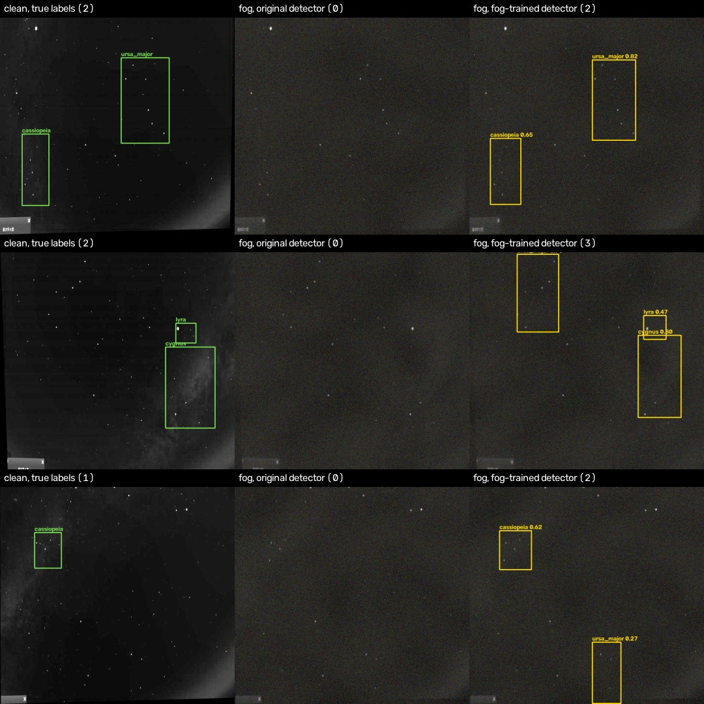

# Constellation Detection in Foggy, Low-Light Night-Sky Images

Computer vision course project (Image Processing and Computer Vision). A
YOLOv8n detector learns to find 16 constellations in night-sky images. We
simulate fog and low light, measure how badly they break the detector, and
compare two ways of recovering it:

1. **Classical spatial enhancement** applied to the image before the unchanged detector.
2. **Training-time augmentation** with simulated fog, with and without copy-paste.

The full write-up is in [`report/IPCV_Report.pdf`](report/IPCV_Report.pdf).
Every number below comes from a result file saved under `results/constellation/`.



## Key results

Test split: 92 images, 283 labelled constellations. mAP50, with mAP50-95 in brackets.

| Detector | Clean | Light fog | Medium fog | Heavy fog |
|---|---|---|---|---|
| Original (trained on clean images) | 0.866 (0.454) | 0.070 (0.032) | 0.022 (0.006) | 0.019 (0.005) |
| Best enhancement + original (NLM denoising) | 0.835 | 0.348 | 0.019 | 0.003 |
| Fog-trained | **0.869** (0.460) | **0.849** (0.458) | **0.833** (0.446) | 0.697 (0.347) |
| Fog-trained + copy-paste | 0.865 (0.451) | 0.847 (0.454) | 0.799 (0.422) | **0.714** (0.336) |

- The original detector collapses even under light fog. Sensor noise is the
  main cause: the training images are almost noise-free, and noise speckles
  look like faint stars.
- Of the classical methods, only denoising helps, and only at the light level.
  Brightening methods hurt, even on clean images.
- Training on simulated fog recovers almost all of the loss and costs nothing
  on clean images. Copy-paste gives no clear extra gain (one run per model).

## Method

### 1. Dataset and leak-free split

Roboflow Universe, `course-work-cytun/constellation-detector` v1 (Public
Domain), 640×640 images, 16 classes. The published splits share source images,
so `src/constellation/resplit_dataset.py` re-splits by source image (seed 0):
**3294 train, 97 validation, 92 test** images. Every experiment uses this split.

### 2. Fog and low-light simulator

`src/constellation/fog_sim.py` works in linear light using the atmospheric
scattering model I = J·t + A·(1 − t), extended with:

- patchy optical depth (a smooth random field),
- forward-scatter blur and a halo around bright sources, with warm light-pollution airlight,
- reduced exposure, Poisson shot noise and Gaussian read noise, then 8-bit JPEG output.

There are three severities (light, medium, heavy). Each image's random seed comes from
its file name, so the output is identical on every run.


Applying one part of the light setting at a time (test mAP50):

| Identity | Fog only | Darkening only | Noise only |
|---|---|---|---|
| 0.867 | 0.789 | 0.842 | **0.140** |

### 3. Classical enhancement before detection

`src/constellation/classical.py` and `src/constellation/enhance.py`. The
original detector is left unchanged, and each method is applied to its input.
Settings were chosen on the validation split only (NLM strength 3 × estimated
noise σ), then the test split was scored once. Test mAP50:

| Enhancement | Clean | Light | Medium | Heavy |
|---|---|---|---|---|
| None | 0.866 | 0.070 | 0.022 | 0.019 |
| NLM denoising (k = 3) | 0.835 | **0.348** | 0.019 | 0.003 |
| Median 3×3 | 0.853 | 0.102 | 0.036 | 0.013 |
| CLAHE | 0.844 | 0.051 | 0.018 | 0.013 |
| Gamma 2.2 | 0.776 | 0.016 | 0.008 | 0.000 |
| Background subtraction | 0.677 | 0.044 | 0.003 | 0.000 |
| Sky restore (denoise + background removal) | 0.613 | 0.212 | 0.023 | 0.019 |
| Multi-scale Retinex | 0.358 | 0.002 | 0.004 | 0.000 |
| Brightening pipeline (Retinex + adaptive gamma + NLM + CLAHE + colour) | 0.068 | 0.071 | 0.005 | 0.001 |
| Histogram equalisation | 0.016 | 0.005 | 0.000 | 0.000 |


### 4. Training with fog and copy-paste

`src/constellation/make_train_sets.py` builds two training sets from the same
training images. Each image gets one random condition: clean, light, medium
or heavy fog.

- **Fog-mix**: fog only.
- **Fog-mix + copy-paste**: before the fog is added, half the images get one
  or two constellations cut from other training images. Only light above the
  crop's background is added, so no rectangle edge is visible.

Both models are YOLOv8n, start from COCO weights and train for 50 epochs at 640 px
on a Colab T4 (`colab/phase5_fog_training.ipynb`). Test images are never
used for training or model selection.

## Demo

A small web page: pick a test image, switch between Clean and Fog (medium),
and see the fog-trained detector's boxes next to the true labels.

```bash
uvicorn src.app.server:app --port 8000   # open http://localhost:8000
```

It needs the re-split dataset in `data/raw/constellations/resplit`. Fogged
images are read from `data/raw/constellations/fog` when present, otherwise
they are generated on the fly.

## Setup

```bash
python -m venv .venv && source .venv/bin/activate
pip install torch==2.14.1 torchvision --index-url https://download.pytorch.org/whl/cpu
pip install -r requirements.txt
```

Evaluation, the simulator, enhancement and the demo all run on a CPU. Training
runs on Colab (`colab/`).

## Reproducing

```bash
# Phase 1: check the dataset and make the leak-free split
python -I src/constellation/verify_dataset.py --help
python -I src/constellation/resplit_dataset.py --help

# Phase 3: fogged test sets and their statistics
python -m src.constellation.fog_sim --split test       # writes data/raw/constellations/fog/
python -m src.constellation.fog_stats --out results/constellation/phase3

# Evaluate any model on any test set
python src/constellation/eval_yolo.py \
    --weights results/constellation/phase5/fogmix/weights/best.pt \
    --data data/raw/constellations/fog/medium/data.yaml --split test --device cpu \
    --out results/constellation/phase5/fogmix_test_medium.json

# Phase 4: enhancement sweep (choose on valid, then score test)
python -m src.constellation.enhance_eval --help

# Phase 5: build the fog / fog + copy-paste training sets for Colab
python -m src.constellation.make_train_sets --help
```

## Repository layout

| Path | Contents |
|---|---|
| `src/constellation/` | dataset checks, re-split, fog simulator, enhancement, training, evaluation, figures |
| `src/app/` | demo page (FastAPI + one HTML file) |
| `colab/` | GPU training notebooks (baseline, fog training) |
| `scripts/` | builders for the Colab notebooks |
| `results/constellation/phaseN/` | saved metrics, weights and figures for each phase |
| `report/` | project report (PDF) |

## Limitations

- The fog is simulated. No labelled real foggy night-sky photos were
  available, so the results show robustness to our fog model, not to real fog.
- The test split is small (92 images) and each model was trained once, so small
  differences between models (such as copy-paste vs no copy-paste) are not meaningful.
- Many dataset images come from the same sky camera, so scene variety is limited.

## Future work

- Test on real foggy night-sky photographs.
- Draw constellation stick figures by fitting catalogue star positions to the
  stars inside each detected box.
- Repeat training with several seeds to measure the copy-paste effect reliably.
